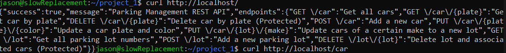

# NGINX Deployment
### Project 1

Student: Jason Dartt

---

## Goal

Run the PHP API through NGINX instead of the built-in PHP test server. 

---

## NGINX config

```nginx
server {
    listen 80;
    server_name localhost;
    root /home/project_1/code; # Make this matches your exact folder path

    index index.php;

    location / {
        try_files $uri $uri/ /index.php?$query_string;
    }

    location ~ \.php$ {
        include snippets/fastcgi-php.conf;

        # Ensure php8.4-fpm.sock matches the php version you have
        fastcgi_pass unix:/var/run/php/php8.4-fpm.sock;
        fastcgi_param SCRIPT_FILENAME $document_root$fastcgi_script_name;
        include fastcgi_params;
    }
}

```

---

## Verifying the path

Before starting nginx use this to ensure the correct permissions are in place.
```bash
sudo chmod -R 755 /filepath/
```
Use `sudo nginx -t` to check the config before starting 

---


## Starting the server

replace php8.3 with your installed version
```bash
sudo systemctl restart php8.3-fpm
sudo systemctl restart nginx
```

---

## Screen Capture

```bash
curl http://localhost/
```



